<picture>
  <source media="(prefers-color-scheme: dark)" srcset="https://capsule-render.vercel.app/api?type=waving&color=0:1a1b26,50:2f4a6f,100:58A6FF&height=190&section=header&text=Kishore%20Mohan&fontSize=46&fontColor=ffffff&align=center&animation=twiceOne&desc=%C2%B7%20nothing%20is%20impossible%20%C2%B7&descSize=16&descAlignY=64&fontFamily=Georgia">
  
</picture>

  

  

  

  my office pet 🐈‍⬛
   
  
   
  (he ships on weekends too)

  

  the graph is delicious

<picture>
  <source media="(prefers-color-scheme: dark)" srcset="https://raw.githubusercontent.com/KishoreM013/KishoreM013/output/github-snake-dark.svg">
  
</picture>

  

  
  &nbsp;
  

<picture>
  <source media="(prefers-color-scheme: dark)" srcset="https://capsule-render.vercel.app/api?type=waving&color=0:58A6FF,50:2f4a6f,100:1a1b26&height=110&section=footer">
  
</picture>

